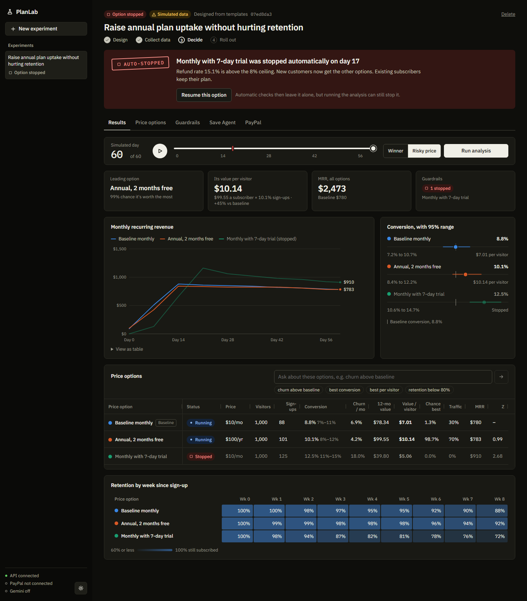
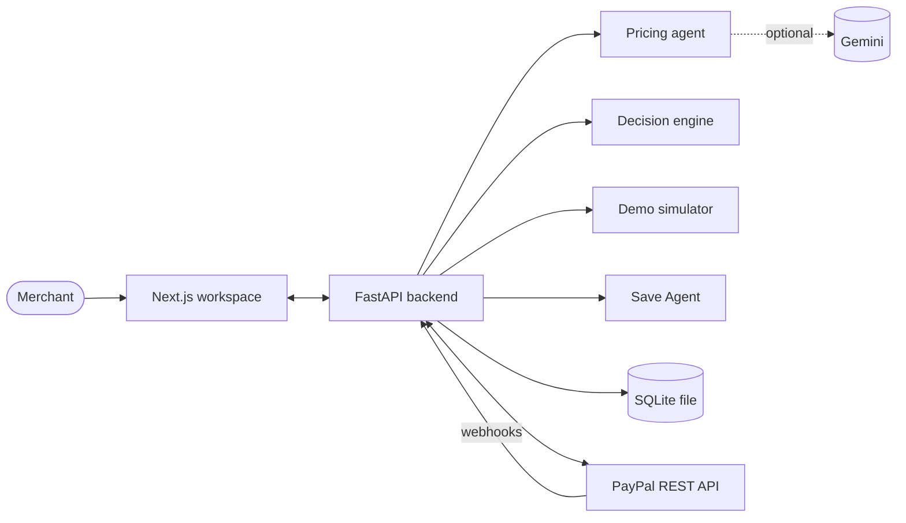

# PlanLab

AI-designed pricing experiments for businesses that bill through PayPal.

Choosing a subscription price often comes down to a guess, and testing one is risky because a bad price can cost real subscribers. PlanLab lets a merchant describe a goal in plain English. It then proposes the prices to test, checks them against PayPal's plan format, splits sign-ups between them, stops any price that starts hurting the business, and picks a winner only when the numbers justify it.

Built for the PayPal AI Hackathon.



## Try it in 3 minutes

You need [Python](https://www.python.org/downloads/) 3.12 or newer and [Node.js](https://nodejs.org/) 24. No API keys or PayPal account are needed for the demo.

**1. Start the API** from the `backend` folder:

```bash
python -m venv .venv
```

Activate it on Windows:

```bash
.venv\Scripts\activate
```

Or on macOS and Linux:

```bash
source .venv/bin/activate
```

Then install and run:

```bash
pip install -r requirements.txt
```

```bash
python -m uvicorn app.main:app --reload
```

**2. Start the workspace** from the `frontend` folder, in a second terminal:

```bash
npm install
```

```bash
npm run dev
```

**3. Open <http://localhost:3000>.**

### What to click

1. Press **Design experiment** to accept the example goal. PlanLab proposes three price options.
2. Press **Simulate a risky price** and don't press anything else. Sixty days of sign-ups replay in a few seconds. The Guardrails tile flips to "1 breached" on day 14, and on day 17 PlanLab stops the trial option by itself: refunds have reached 15.1% against an 8% limit. A red mark shows the day on the timeline. The trial gets the most sign-ups (12.5%), but it's worth the least ($5.06 per visitor, against $10.14 for the annual plan), and the Traffic column now gives it nothing.
3. Press **Run analysis**. It judges what's left: the annual plan has a 98.7% chance of beating the baseline and a win needs 99%, so the verdict is "No clear result yet". **Resume this option** undoes the stop if you disagree with it.
4. Press **Winner** on the timeline to replay a different scenario. Nothing gets stopped this time. Press **Run analysis** again and the annual plan wins: $14.23 per visitor against $7.01.
5. Press **Propose rollout**, then **Approve rollout**. New customers now all get the winner, and existing subscribers keep the price they signed up for.
6. Press **New experiment**. PlanLab remembers the results: past winners are re-tested first and stopped prices are dropped.

The scenarios are seeded, so those numbers are the same on every run, and simulated data is always labelled on screen. Experiments are saved to `backend/planlab.db`, so they survive a restart. To start completely fresh, stop the API and delete that file.

Drag the timeline to any day to see what PlanLab knew at that point. Running the analysis on an early day gives the decision it would have made then.

Simulated customers all arrive in the first 14 days, so the day-17 stop in step 2 changes who the next customers would be offered, not the numbers already on screen. To see a stop turn later arrivals away, set the refund ceiling to 5% on the Guardrails tab before simulating.

## What's in the workspace

| Tab | What it does |
|---|---|
| **Results** | Timeline replay, headline figures, revenue and conversion charts, the price options grid, a retention table, and an assistant that filters and ranks the grid ("churn above baseline", "best conversion") |
| **Price options** | Each proposed price, why it was proposed, whether it's a valid PayPal plan, and the exact plan request |
| **Guardrails** | How each option sits against its limits, the limits themselves, which you can edit, and the automatic checks: on or off, when they last ran, every stop with a way to undo it, and whether its alert went out |
| **Save Agent** | Offers made to subscribers who are about to leave, an audit log where you can change any offer, and the rules the agent must follow |
| **PayPal** | Connection status and setup steps, plan publishing, sandbox sign-ups with an optional customer ID, and transaction history |

"Price option" is what the code calls an **arm**, the usual term in A/B testing.

## How PlanLab decides

The decisions come from statistics and fixed rules, so every one can be explained and tested. The AI only proposes prices and words the explanation.

**Everything is judged on value per visitor:** expected 12-month revenue from one visitor, which is the sign-up rate × what a subscriber is worth. Sign-ups alone can mislead. A price that attracts lots of people who soon cancel loses to one that attracts fewer who stay, and a higher price can win even with slightly fewer sign-ups.

**What a subscriber is worth** follows the plan's real payment schedule over 12 months: a $100 annual plan pays up front, a monthly plan pays while the subscriber stays, a trial delays the first payment, and setup fees and refunds are counted. Each payment due at month `t` counts `price × (1 - refund rate) × (1 - churn)^t / (1 + d)^t`, with a 1% monthly discount `d`.

**Churn is measured per month of subscriber time**, so people who joined last week don't make an option look more loyal than it is. The retention table works the same way and stays blank for weeks too few subscribers have reached.

**Stop an option** when it crosses a limit. All of them can be changed per experiment.

| Guardrail | Stops when | Default |
|---|---|---|
| Retention floor | Share of subscribers projected to remain after 60 days falls below the limit | 80% |
| Refund ceiling | Refunds per payment go above the limit | 8% |
| Dispute ceiling | Disputes per sign-up go above the limit | 2% |
| Churn ratio | Monthly churn is this many times the baseline, with p < 0.01 | 1.30× |

The first three need 30 sign-ups (also adjustable) and at least a 90% chance the limit is really crossed, so a brief wobble doesn't stop anything.

**Automatic checks apply those limits without anyone pressing a button.** Experiments with real data are checked every 15 minutes, and again whenever you change a limit. A simulated run is checked day by day as it's generated, so you can watch the stop happen in the replay. A stopped option gets no new customers, its existing subscribers keep their plan, and nothing is sent to PayPal. Because these checks never stop looking, their bar is higher than the analysis: 99% confidence instead of 90%, and p < 0.002 instead of p < 0.01 for churn. They never stop the baseline or pick a winner. **Resume this option** undoes a stop, and the checks then leave that option alone, though running the analysis can still stop it. You can turn them off per experiment on the Guardrails tab, and [get an alert](#get-an-alert-when-a-price-is-stopped) when one stops a price.

**Pick a winner** when an option is at least 99% likely to be worth more per visitor than the baseline, corrected for how many options are competing. Every option needs 30 sign-ups and 15 subscriber-months first, so churn has had time to show. If every challenger is that likely to be worse, the baseline wins and the verdict is to keep the current price. Otherwise, keep testing.

**New customers are split by Thompson sampling on value per visitor**: an option's share of traffic follows its chance of being worth the most. Every option keeps at least 5%, and the current price keeps at least 30%, which limits exposure to unproven prices and keeps the comparison reliable. Once a rollout is approved, all new customers get the winner.

**Returning customers keep their offer.** Pass a `visitor_id` to `POST /experiments/{id}/assign` or `/paypal/subscribe`, and the same person sees the same option, unless it has been stopped or the test has been rolled out. The choice is random, not based on who the customer is. Customers do see different offers during a test, which is how any price test works, so check the rules where you sell before using it with real customers.

### How reliable is that?

We chose these thresholds by simulating thousands of tests with the real engine, checking results every week for 8 weeks, as a merchant would. Checking repeatedly is what inflates false alarms. About 150–300 simulated tests stand behind each figure, so treat them as approximate.

| With 3 options | Result |
|---|---|
| Identical prices: a false winner is declared, 400 visitors a week per option | about 4% (the first version of this rule: 15%) |
| Identical prices: an option is wrongly stopped | about 4–6% |
| A real 30% lift in sign-ups is found, 1,000 visitors a week per option | about 80% |
| A real 30% lift in sign-ups is found, 400 visitors a week per option | about 30% |

At low traffic PlanLab mostly says "keep testing", rarely picks the wrong option, and needs longer than 8 weeks to detect smaller differences. `tests/test_math.py` re-runs a smaller version of this simulation, so a change that breaks it fails the tests.

Automatic checks were simulated separately, because they look far more often. These runs cover 3 options over 60 days, with a few hundred tests behind each figure, except the 15-minute rows, which took much longer and have fewer (120 and 40).

| Automatic checks | Result |
|---|---|
| Identical healthy prices, checked daily, 10 sign-ups a day per option: an option is wrongly stopped | about 1.5% of tests (at the analysis's thresholds: about 24%) |
| The same, 3 sign-ups a day | about 0.5% |
| The same, checked every 15 minutes, 10 sign-ups a day | about 1% (1 test in 120) |
| A truly risky price (20% monthly churn, 15% refunds), checked daily, 10 sign-ups a day | all caught, typically by day 6 |
| The same, 3 sign-ups a day | all caught, typically by day 18 |
| The same, checked every 15 minutes, 10 sign-ups a day | all caught, typically by day 5 |

`tests/test_watcher.py` re-runs a smaller version of this too.

The grid also shows a classic Z-score on conversion (significant at 1.96 or more) for reference. `POST /engine/decide` still offers that simpler Z-test rule for a one-off check from raw counts.

**The Save Agent** picks an offer by rule, not by AI:

| Situation | Offers, in order of preference |
|---|---|
| Subscriber is price-sensitive | Discount, downgrade, pause |
| Failed payment, or not using the product | Pause, downgrade, discount |
| Reason unknown | Downgrade, discount, pause |
| Never paid, or already at the offer limit | Let them go |

## Get an alert when a price is stopped

PlanLab can tell you in Slack, by email, or both when automatic checks stop a price on real data. Simulated runs and stops from **Run analysis** don't send alerts. Without these settings, stops still happen and show in the workspace.

**Slack:** create an app at <https://api.slack.com/apps>, turn on **Incoming Webhooks**, add a webhook to a channel, and put its URL in `backend/.env`. Treat that URL like a password. Any other service that accepts a JSON `text` field works too.

```
ALERT_WEBHOOK_URL=https://hooks.slack.com/services/...
```

**Email:** add your mail server's details. The password is only ever sent over an encrypted connection.

```
ALERT_EMAIL_TO=you@example.com, teammate@example.com
SMTP_HOST=smtp.example.com
SMTP_PORT=587
SMTP_USERNAME=...
SMTP_PASSWORD=...
SMTP_FROM=planlab@example.com
```

Restart the API, then press **Send test alert** on the Guardrails tab to check the settings. Set `FRONTEND_URL` to the workspace's real address, so the link in each alert works for other people.

A failed send is tried again after 1, 5, 15 and 60 minutes, even if the API restarts in between. If one channel works and the other doesn't, only the failed one is retried. The Guardrails tab shows what happened to each alert.

## Connect a real PayPal sandbox

Everything above works without this. Start by copying the settings template, from the `backend` folder:

```bash
cp .env.example .env
```

1. Create a sandbox app in the [PayPal developer dashboard](https://developer.paypal.com/dashboard/applications/sandbox), then put its keys in `backend/.env` as `PAYPAL_CLIENT_ID` and `PAYPAL_CLIENT_SECRET`.
2. Create the catalog product that plans belong to, then add the `PAYPAL_PRODUCT_ID` it prints to `.env`:

   ```bash
   python scripts/create_product.py
   ```

3. Restart the API. The PayPal tab should now say "Connected to sandbox".
4. On that tab, publish the plans, create a subscription, and finish the checkout with a [sandbox buyer account](https://developer.paypal.com/dashboard/accounts). PayPal returns you to PlanLab, which records the sign-up.

**Webhooks** keep payments, cancellations and refunds flowing in by themselves. They need a public URL, so deploy the API or use a tunnel. Point a PayPal webhook at `https://<your-host>/webhooks/paypal` and put its ID in `.env` as `PAYPAL_WEBHOOK_ID`. Without webhooks, the **Sync** button on the PayPal tab pulls the latest status instead.

### Settings

All are optional for the demo. `backend/.env.example` lists every one.

| Setting | Purpose |
|---|---|
| `GEMINI_API_KEY`, `GEMINI_MODEL` | Lets Gemini design options and write explanations. Without a key, PlanLab uses built-in templates. The default model is `gemini-3.8-flash` |
| `PAYPAL_CLIENT_ID`, `PAYPAL_CLIENT_SECRET`, `PAYPAL_PRODUCT_ID` | PayPal sandbox access |
| `PAYPAL_WEBHOOK_ID` | Verifies incoming webhook signatures |
| `PAYPAL_WEBHOOK_VERIFY` | Set to `false` only to test locally with hand-made events |
| `FRONTEND_URL` | Where PayPal sends buyers after checkout, and where links in alerts point. Change it if the workspace isn't on port 3000 |
| `ALERT_WEBHOOK_URL` | Slack incoming webhook for alerts about automatic stops |
| `ALERT_EMAIL_TO`, `SMTP_HOST`, `SMTP_PORT`, `SMTP_USERNAME`, `SMTP_PASSWORD`, `SMTP_FROM` | Who gets those alerts by email, and the mail server that sends them |
| `NEXT_PUBLIC_API_URL` | In `frontend/.env.local`: where the workspace finds the API. Defaults to `http://localhost:8000` |
| `GUARDRAIL_CHECK_SECONDS` | How often real data gets its automatic guardrail check. Defaults to 900 (15 minutes). `0` turns the background checks off |
| `PLANLAB_DB` | Where experiments are saved. Defaults to `backend/planlab.db`. Set it empty to keep data in memory only |
| `CORS_ORIGINS` | Other websites allowed to call the API, comma-separated. localhost is always allowed |
| `PLANLAB_API_TOKEN`, `NEXT_PUBLIC_API_TOKEN` | A shared secret every API call must send. Set the same value in the backend and frontend |

## How it fits together



Real webhooks and simulated events use the same event format, so the decision engine treats them identically.

```text
backend/
  app/
    main.py                  API routes
    experiments.py           One view of an experiment: metrics, value model, traffic split
    watcher.py               Automatic guardrail checks
    alerts.py                Slack and email alerts about what those checks stop
    agent/                   Pricing agent and plain-English explanations
    engine/                  Value model, Bayesian layer, guardrails, decision logic
    metrics.py               Turns raw events into per-option numbers
    persistence.py           Saves everything to SQLite
    security.py              Blocks requests from other websites, optional API token
    paypal_*.py              PayPal client, plans, subscriptions, webhooks, transactions
    save_agent.py            Offer rules and audit log
    assistant.py             Rule-based question answering for the grid
    simulate.py              Seeded demo scenarios
    memory.py                What past experiments taught the agent
  scripts/create_product.py  One-time PayPal catalog setup
  tests/
frontend/app/
  page.tsx                   Workspace state and data flow
  components/                Tabs, charts and grids
  subscribe/                 Pages PayPal returns buyers to
docs/
  contracts.md               Data formats and API routes
  v2-plan.md                 Scope and hand-offs (its status table predates some later work)
team-plan.md                 Roles and hackathon plan
```

**API reference:** with the backend running, interactive docs are at <http://localhost:8000/docs>. `docs/contracts.md` covers the data formats.

## Tests

From `backend`, with the virtual environment active:

```bash
python -m pytest
```

From `frontend`, this also type-checks the code:

```bash
npm run build
```

The backend tests cover the math with hand-calculated examples and simulated false-alarm rates, plus the API, both demo scenarios, guardrails and their automatic checks, alerts, the Save Agent, memory, saving to disk, and the PayPal routes and webhooks against a fake PayPal. There are no automated frontend tests yet.

## Current status

### Limits to know about

- **There's no real login.** Requests from other websites are refused, and `PLANLAB_API_TOKEN` adds a shared secret, but that secret ends up in the browser's code. Put a real login in front before deploying this publicly.
- **Rollout and the Save Agent are dry runs.** Their PayPal requests are built and logged, not sent, and the workspace says so wherever they appear.
- **Alerts haven't been sent through real Slack or a real mail server.** They've been tested end to end against local stand-ins, because no real accounts were available. **Send test alert** is the way to confirm yours.
- **Automatic checks run inside the API process.** If the API isn't running, nothing is checked. Only guardrails are automatic: picking a winner and running the Save Agent's sweep still need someone to press a button.
- **Stops don't lift by themselves.** Loosening a limit later leaves an option stopped until you resume it.
- **Real PayPal and Gemini haven't been run against this version.** The PayPal routes and tab have been tested against a local stand-in for PayPal's API, and Gemini against a fake response, because no keys were available. The commit history records a live sandbox subscription flow verified from the backend on an earlier version.
- **Existing subscribers aren't moved after a rollout.** They keep the price they signed up for. Moving them would need buyer approval through PayPal, which isn't built.
- **PayPal has no timed pause.** A pause is a suspend, and reactivating it later still needs a scheduled worker.
- **The value model makes simplifying assumptions.** Churn is treated as constant from month to month, and only the first 12 months count, so an annual plan's renewal isn't credited and a monthly plan's value beyond a year isn't either.
- **SQLite suits one running copy of the API.** Running several would need a shared database.

### Sponsor tools

| Tool | Status in this codebase |
|---|---|
| **PayPal** | Subscriptions, billing plans, webhooks and transaction search are all implemented |
| **Gemini** | Wired in for designing options and writing explanations, and falls back to templates without a key |
| **AG Grid** | The price options grid and Save Agent log use AG Grid Community. AG Studio isn't integrated |
| **APIMatic** | Plans are checked by a local JSON Schema. When its settings are present, each plan also goes to APIMatic, but that hasn't been verified against a real account |
| **KERNEL** | A checkout bot and simulated clock exist on the `feature/person-d-simulation` branch, not yet merged |
| **Bryntum** | Not integrated. The timeline's checkpoints are built in-house |
| **Render** | Not integrated. This repository has no deployment setup yet |

### Licence

This repository doesn't have a licence yet. The hackathon checklist in `team-plan.md` requires one.
